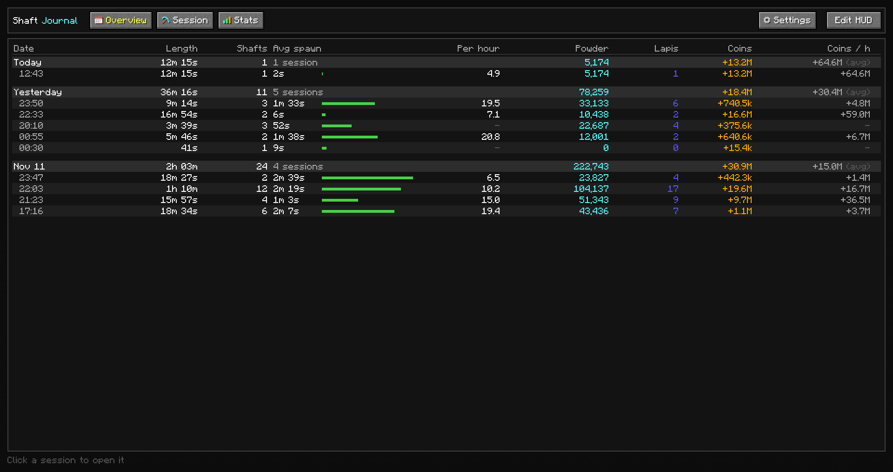
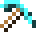
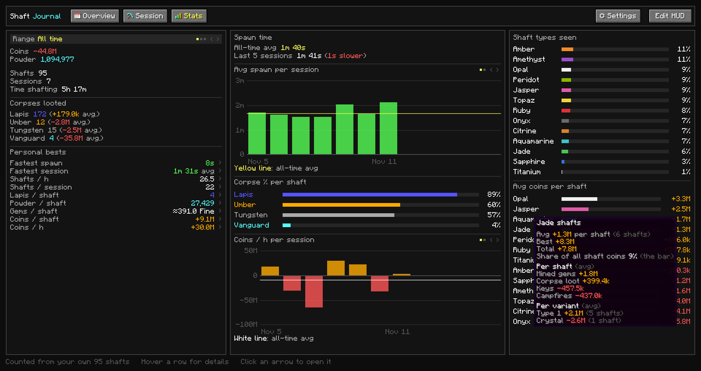
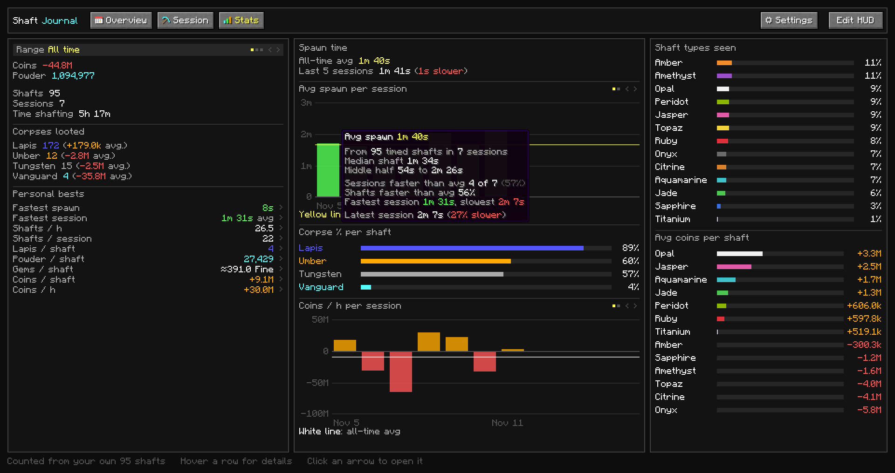
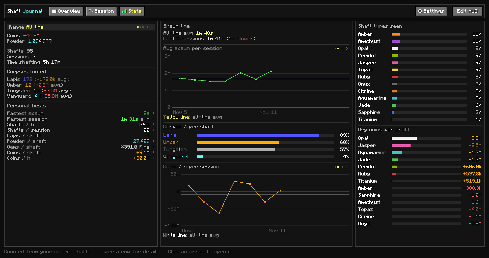

  

  Multi Purpose Mining Mod for Hypixel SkyBlock. 
  (For now, mainly focused around the Glacite Tunnels!)

  <b>Surveyor</b>: <i>A person whose job is to measure and record the details of areas of land</i>

  
  
  

  <a href="#the-cool-features"><b>Features</b></a>&nbsp;&nbsp;&nbsp;&nbsp;
  <a href="#install"><b>Install</b></a>&nbsp;&nbsp;&nbsp;&nbsp;
  <a href="#commands-to-know"><b>Commands</b></a>&nbsp;&nbsp;&nbsp;&nbsp;
  <a href="#is-it-safe"><b>Is it safe?</b></a>&nbsp;&nbsp;&nbsp;&nbsp;
  <a href="#bugs-and-ideas"><b>Bugs and ideas</b></a>

  

## The Cool Features

<table>
<tr>
<td width="50%" valign="top">

<h3> Shaft tracking</h3>

Saves every shaft automatically:
- shaft type and variant (type 1, type 2, crystal)
- corpses, looted or not, and their loot
- powder, Mayhem buff, cold, campfires and Suspicious Scrap
- mined gems, from your Sacks
- spawn time: mining time in the Dwarven Mines until "WOW!" (breaks count as 40 s max)
- chat summary after each shaft

</td>
<td width="50%" valign="top">

<h3> Real Value's</h3>

- coin value per shaft: mined gems, drops, corpse loot, scrap and crystals, minus keys and campfires
- Bazaar, lowest BIN or NPC prices
- each shaft keeps the prices from that day
- sell price, gem tier and Bazaar tax in `/sv settings`

</td>
</tr>
<tr>
<td width="50%" valign="top">

<h3> Shaft Journal <code>/sv</code></h3>

- sessions grouped by day: length, shafts, avg spawn, shafts/h, powder, Lapis, coins and coins/h
- every shaft in a session, with its loot and coin breakdown
- sessions start and end automatically (15 min without mining ends one)
- `/sv session new` starts a new session

</td>
<td width="50%" valign="top">

<h3> Stats <code>/sv</code> → Stats</h3>

- drop chances per corpse type, from your own corpses
- avg coins per shaft type
- coins/h and avg spawn per session, as bars or a line
- personal bests
- range: all time, last 7 days or last 5 sessions

</td>
</tr>
<tr>
<td colspan="2" valign="top">

<h3> HUD <code>/sv</code> → Edit HUD</h3>

- default boxes: session, spawn timer and current shaft
- add your own boxes and lines: spawn timer, shafts/h, powder, coins, corpses, cold, FPS, ping, TPS and more
- ranges: this shaft, session, per hour or all-time
- colour rules, f.e. spawn timer red above your avg
- snapping, presets, undo and redo
- custom text with `&` colour codes and `{tags}`

</td>
</tr>
</table>

<b>All screenshots</b> (click to open)

 

| | |
|:-:|:-:|
|  Sessions by day |  Session with a shaft opened |
|  Drop chances |  Avg coins per shaft type |
|  Spawn time stats |  Line charts |
|  Edit HUD |  Settings |

## Install

1. Minecraft 26.2 with [Fabric Loader](https://fabricmc.net/use/) 0.20.1+
2. Put these in your `mods` folder:
   - [Fabric API](https://modrinth.com/mod/fabric-api)
   - [owo-lib](https://modrinth.com/mod/owo-lib) 0.13.1+ for 26.2
   - Surveyor from [Releases](../../releases)
3. Join Hypixel and type `/sv`

Coming from the older private mod ShaftJournal? Remove the old jar. Your data and hotkey will move over automatically.

## Commands to know

| Command | Opens |
| --- | --- |
| `/sv` | journal (`/surveyor` and `/sj` work too) |
| `/sv settings` | settings |
| `/sv session new` | starts a new session |

The journal can also get a hotkey in Controls, under Surveyor.

## More info

### Is it safe?
Surveyor only reads what your game already receives and draws its own screens. It never sends chat, commands,
clicks or packets (This might change in the future), and has no ESP or x-ray. The only thing it downloads is
prices, from Hypixel's API and a lowest BIN list (EliteSkyblock or hysky.de).

### Your data
Saved in `.minecraft/skysurveyor/`. Updates keep your old data. BUT, it is never a bad idea to keep a local backup.

### Bugs and ideas
Open an [issue](../../issues/new/choose). For bugs, add your Surveyor version and a screenshot.

### License
[LGPL-3.0](LICENSE). Item IDs come from [NotEnoughUpdates-REPO](https://github.com/NotEnoughUpdates/NotEnoughUpdates-REPO)
(MIT), see [NOTICE.md](NOTICE.md). Build it with `./gradlew build` (Java 25).

### Credits
Made by [forenick](https://github.com/forenick).

Before you ask, Yes i did use some AI to make this mod. Specifically, Claude (Anthropic). Claude if u read this ur the goat
