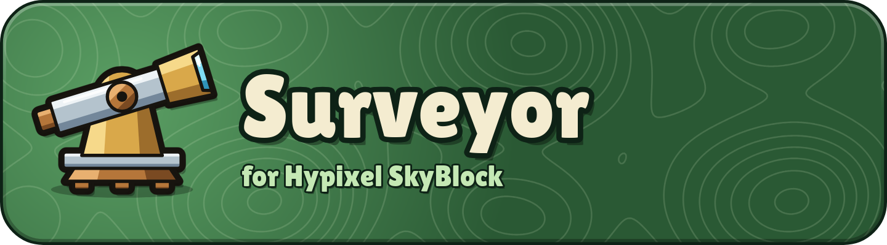
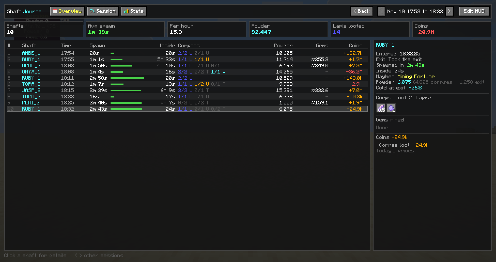
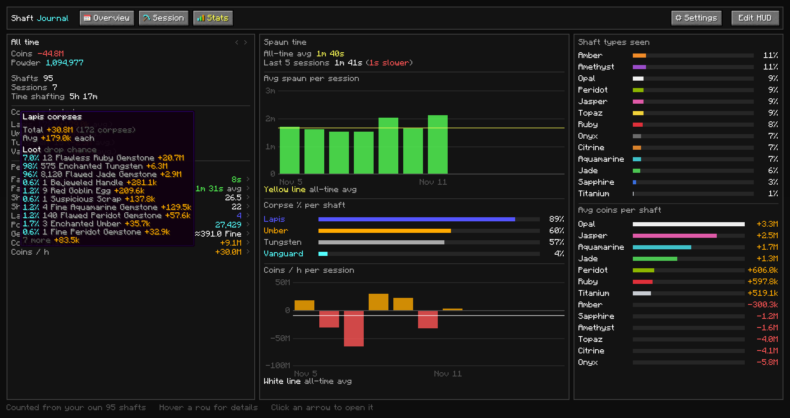
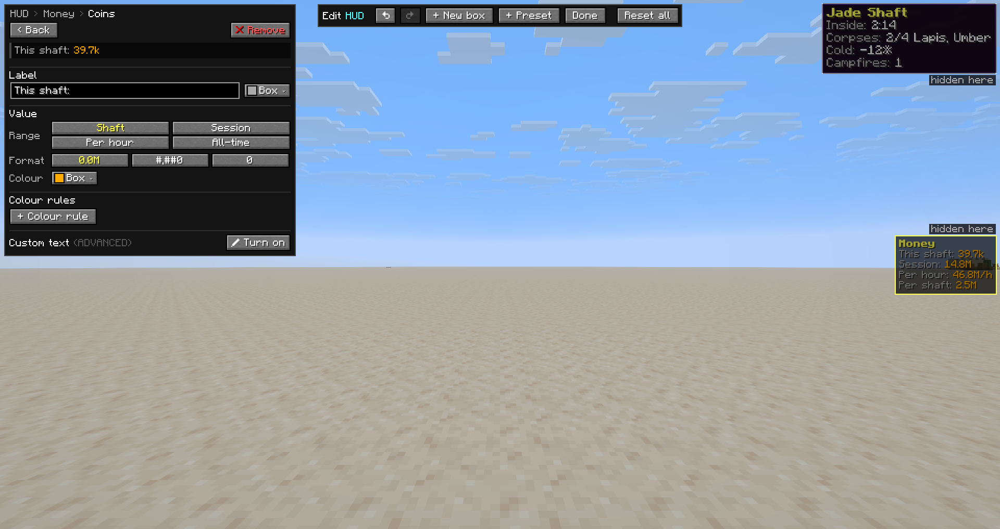
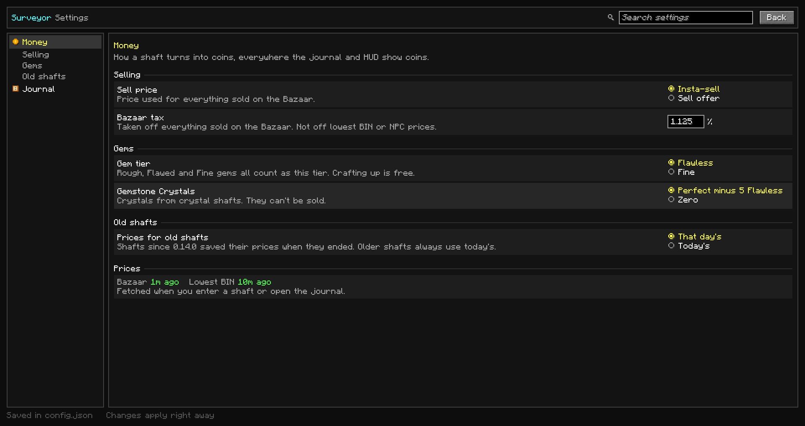

<p align="center">
  
</p>

<p align="center">
  A journal, money tracker and HUD for Glacite Mineshafts on Hypixel SkyBlock.<br>
  Fabric, Minecraft 26.2, client-side and information-only.
</p>

---

Surveyor logs every Glacite Mineshaft you enter: what spawned, what you looted, how long it took to find and what
it was worth in coins. It turns that into sessions, stats and a HUD you can build yourself. Shafts come first. More
mining features are planned, and maybe other parts of SkyBlock later.

It only reads what your game already receives and draws its own screens. It never sends chat, commands, clicks or
packets of its own, and it has no ESP. See [Is it safe?](#is-it-safe).


## Features

### Shaft Journal and sessions
- **Every shaft is detected and saved** from chat, the scoreboard and the tab list: shaft type and variant (type 1,
  type 2 or crystal), each corpse and whether you looted it, corpse loot, the Mayhem buff, powder (corpses and exit
  bonus), cold at exit, campfires, Suspicious Scrap, pristine procs and how you left (exit, warp or frozen).
- **Mined gems** are counted from your Sacks, minus corpse loot and Supercrafts, plus an estimate for the last gems your
  Sacks hadn't reported yet when you left. Shown in Fine.
- **Spawn timer**: your mining time in the Dwarven Mines until "WOW! You found a Glacite Mineshaft portal!". Block
  hits and pickaxe abilities (Pickobulus) count as mining, and a break counts as 40 seconds at most, so a trip to
  the AH doesn't wreck your average.
- **Sessions** end after 15 minutes without mining in the Dwarven Mines or shafting (mining elsewhere doesn't keep
  one going), or when you start a new one with `/sv session new`.
- **Overview tab**: every session, grouped by day with day totals (or one row per session). Length, shafts,
  average spawn, shafts per hour, powder, Lapis, coins and coins per hour. Click a session to open it, then step
  through the others with `<` `>`.
- **Session tab**: the session you're in, with tiles (shafts, average spawn, per hour, powder, Lapis looted, coins),
  a row per shaft and a detail view for the shaft you click: entered, exit, spawn time, time inside, Mayhem buff,
  powder split, cold, corpse loot as item icons, mined gems and a coin breakdown.
- Rough, Flawed and Fine gems from corpses are merged into one "Gemstones" slot counted in Fine (hover it for the
  full list).



### Chat summary
After every shaft a short summary in chat: the shaft, time inside and how you left, spawn time, corpses looted per
type, mined gems in Fine with pristine procs, powder (corpses and exit), campfires, coins with their parts, and the
session so far with its average spawn.

### Stats tab
- **Pick a range**: All time, Last 7 days or Last 5 sessions. The whole tab follows it.
- **Totals**: coins, powder, shafts, sessions and time shafting. Hover Coins for a full breakdown of where your coins
  came from (hold Shift for the short version).
- **Corpses looted** per type with the average coins per corpse. The tooltip lists that type's loot with **drop
  chances counted from your own corpses**, like `7.0% 12 Flawless Ruby Gemstone`.
- **Personal bests** with an arrow to the shaft or session: fastest spawn, fastest session, shafts per hour, shafts
  per session, Lapis, powder, gems and coins per shaft, and coins per hour.
- **Spawn time**: your all-time average, your last 5 sessions compared to it, and a chart of the average spawn per
  session.
- **Corpse % per shaft**: how often each corpse type shows up.
- **Coins per hour per session** chart. Both charts switch between bars and a line, and the average line has a
  tooltip with the median, best and worst session and how your latest session compares.
- **Shaft types seen** with their share, and **average coins per shaft type**, split per part and per variant in
  the tooltip.



### Coins and prices
- **Every shaft gets a coin value**: mined gems, other drops, corpse loot, Suspicious Scrap and the crystal of a
  crystal shaft, minus the keys you used and your campfires (Refined Umber plus 16 Match-Sticks).
- Bazaar items use insta-sell or sell offer minus the Bazaar tax, auction-only drops use the lowest BIN, and items
  with no market use the NPC price. Keys and campfire materials cost their insta-buy price.
- **Each shaft saves the prices it was valued at**, so old shafts keep their value when prices move (or switch
  to today's prices in the settings).
- Prices are fetched when you enter a shaft or open the journal, never on a timer, and kept on disk, so coins also
  work offline with the last prices.
- Coins show up in the journal tables, the Session tiles, the Stats tab and the HUD.

### HUD and editor
- **Movable boxes** with any lines you like. It starts with a Session box, a spawn timer under the crosshair and a
  box for the shaft you're in.
- **Values**: spawn timer, average spawn, shafts, shafts per hour, powder, Fine from corpses, shaft type, time
  inside, corpses, cold, campfires, coins, coins per shaft, FPS, ping, TPS, clock, Surveyor version and Minecraft
  version. Many of them can show this shaft, the session, per hour or all-time.
- **Ping that works on Hypixel**, timed from the block packets the game already sends and the server's answers
  (Hypixel's tab list always says 1). **TPS** from the server's tick packets.
- **Edit HUD** (from the journal):
  - drag boxes with snapping and guide lines (hold Ctrl to place freely), nudge with the arrow keys, scroll to
    resize from 0.5× to 2×
  - per box: title, background, alignment, label and value colours, bold, and where it shows (in shafts, in the
    Mines, elsewhere)
  - per line: label, range, number format and colour, drag to reorder
  - **colour rules**: over or under a number or another value, f.e. the spawn timer turns red above your average
  - **custom text** with `&` colour codes and `{value:range:format}` tags
  - **presets**: Spawn, Session, Current shaft, All-time totals, Money and Performance
  - undo and redo (Ctrl+Z, Ctrl+Shift+Z), and changes save by themselves



### Settings
A settings page (journal's Settings button or `/sv settings`) with categories, a search box, a reset button per
setting and Reset all per category. Changes apply right away and save to `config.json`, which you can still edit by
hand.
- **Money**: sell price (insta-sell or sell offer), Bazaar tax, gem tier (Flawless or Fine), Gemstone Crystals
  (Perfect minus 5 Flawless, or zero) and prices for old shafts (that day's or today's).
- **Journal**: group sessions by day.



### Your data is safe across updates
Every build is tested against real files that older versions wrote, so an update can't lose or change your old
shafts, HUD or settings. Files are written through a temp file, and a HUD file that needs converting or repairing
is backed up first.

### Recorder (for development)
`/sv record start` and `/sv record stop` write chat, action bar, titles, scoreboard, tab list, armor stands, your
held item and block hits to `recordings/*.jsonl`, and `/sv mark <note>` adds a note. Recordings are how new game
text gets supported. They contain other players' names and chat, so don't post them publicly.

## Planned
- **Shaft calculator**: whether a corpse is worth its key, whether a campfire pays off and when, with cold and
  Fortunate Freezing in the mix.
- More mining features, and maybe other parts of SkyBlock later.

## Commands
`/surveyor`, `/sv`, `/sj` and `/shaftjournal` all work the same way.

| Command | What it does |
| --- | --- |
| `/sv` | Open the journal |
| `/sv settings` | Open the settings page |
| `/sv session new` | Start a new session |
| `/sv record start`, `/sv record stop` | Start or stop a recording |
| `/sv mark <note>` | Add a note to the recording |

**Hotkey**: "Open shaft journal" under Surveyor in Controls. Unbound by default.

## Install
1. Minecraft **26.2** with **Fabric Loader** 0.20.1 or newer (Java 25).
2. Put these in your `mods` folder:
   - [Fabric API](https://modrinth.com/mod/fabric-api)
   - [owo-lib](https://modrinth.com/mod/owo-lib) 0.13.1 or newer for 26.2
   - `skysurveyor-<version>.jar` from [Releases](../../releases)
3. Join Hypixel and type `/sv`.

**Coming from ShaftJournal?** Remove the old `shaftjournal-*.jar`. The game won't start with both. Your data and
your hotkey move over by themselves.

## Where your data is
Everything lives in `.minecraft/skysurveyor/`:

| File | What's in it |
| --- | --- |
| `journal.jsonl` | Every shaft, one per line, with the prices it was valued at |
| `hud.json` | Your HUD layout |
| `config.json` | Your settings |
| `prices.json`, `items.json` | Price cache, rebuilt from the APIs |
| `recordings/` | Recordings, if you made any |

The first time Surveyor starts it moves the old `.minecraft/shaftjournal/` (or `shafttools/`) folder there. It never
overwrites an existing folder, and if the move fails it keeps using the old one.

## Is it safe?
Surveyor is **information-only**:
- It never sends chat, commands, clicks or packets on its own and never simulates input.
- It never draws anything through walls (no x-ray, no ESP).
- It registers no network channels and only reads what the client already received. Its mixins only read.
- Keybinds only open its own screens.
- The only internet traffic is fetching prices: Hypixel's public API (Bazaar and item list), and lowest BINs from
  EliteSkyblock or hysky.de. Nothing about you or your game is sent.

Whether a mod is allowed is always up to Hypixel. Surveyor is built to only show information, like a notebook next
to your game.

## Building
```
./gradlew build
```
Needs a Java 25 JDK. The jar ends up in `build/libs/`.

## Credits
Made by [forenick](https://github.com/forenick).

Before you ask, Yes i did use some AI to make this mod. Specifically, Claude (Anthropic). Claude if u read this ur the goat
